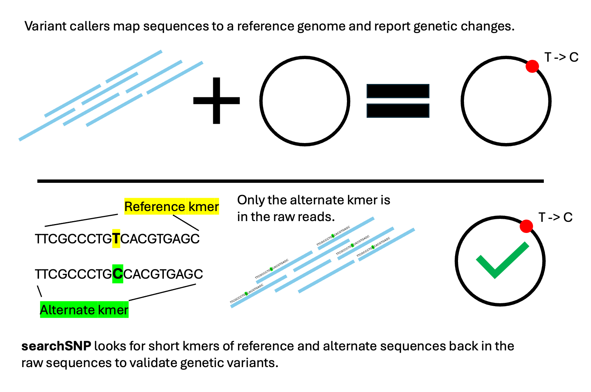

# searchSNP

**searchSNP** checks whether called SNPs and indels in a vcf are real by looking for them directly in the raw reads that were used to generate the vcf.

**This is a development package and if you use it, we recommend checking the findings make sense for your usage (e.g. compare the proportions you get from searchSNP against those from your variant caller). We welcome any [Issues](https://github.com/padpadpadpad/searchSNP/issues) to improve the workflow and documentation.**

Calling SNPs in mixed populations is renowned for high rates of false positives. These can be hard to distinguish and filter. This tool attempts to overcome this by searching for short kmers of each reference and alternate sequence in the raw reads. For every row of a VCF from a variant caller (e.g. from [breseq](https://github.com/barricklab/breseq)) it builds the reference and alternate DNA sequence around the variant and counts **exact** matches of those sequences in the forward and reverse reads. From this, you can compare the presence/absence and proportion to that of your variant caller.

There are many filters that can be applied to attempt in an attempt to balance false positives and false negatives. Many of these are summarised and discussed in [Bush et al. 2021](https://doi.org/10.1099/mgen.0.000615). 

**searchSNP** allows the following filters:

- If the predicted variant **IS NOT** in any of the raw reads, then it is likely a false positive.
- If the predicted variant **IS** in the reads of the ancestral/reference genome (due to homologous regions), it is likely a false positive.

## Install

Prebuilt self-contained binaries for Windows, macOS and Linux are attached to every
[release](https://github.com/padpadpadpad/searchSNP/releases). They need no Rust or other software installed.

Download, unpack, and put `searchSNP` (`searchSNP.exe` on Windows) anywhere on your `PATH`. Or use a one-line installer:

**macOS and Linux** - installs to `~/.local/bin` (set `INSTALL_DIR` to change):

```sh
curl -fsSL https://raw.githubusercontent.com/padpadpadpad/searchSNP/main/install.sh | bash
```

**Windows (PowerShell)** - installs to `%LOCALAPPDATA%\searchSNP\bin` and adds it to your user `PATH`
(set `$env:INSTALL_DIR` to change); open a new terminal afterwards:

```powershell
irm https://raw.githubusercontent.com/padpadpadpad/searchSNP/main/install.ps1 | iex
```

**With Rust** (any platform):

```sh
cargo install --git https://github.com/padpadpadpad/searchSNP
```

**From source:**

```sh
git clone https://github.com/padpadpadpad/searchSNP
cd searchSNP
cargo build --release
# binary: target/release/searchSNP
```

**macOS note:** if you downloaded a binary with a browser rather than the installer, macOS may refuse to run it ("cannot be opened because the developer cannot be verified"). Right-click the file and choose Open, or run `xattr -d com.apple.quarantine searchSNP`.

**If `searchSNP` is not found:**

- In the folder you unpacked it into, run `./searchSNP` - Linux and macOS do not look in the current directory, so the name on its own is not enough.
- Straight after the installers, the binary is at `~/.local/bin/searchSNP`. Run that full path, or add the directory to your `PATH` and open a new terminal. Use `~/.zshrc` for zsh, `~/.bashrc` for bash:

```sh
# bash
echo 'export PATH="$HOME/.local/bin:$PATH"' >> ~/.bashrc && source ~/.bashrc

# zsh
echo 'export PATH="$HOME/.local/bin:$PATH"' >> ~/.zshrc && source ~/.zshrc
```

- Check the install with `searchSNP --version`.

## Licensing

This program is licensed under an MIT license.

## AI use

This program is a re-write of janky R code written by Daniel Padfield to create the search sequences and [jellyfish](https://github.com/gmarcais/jellyfish). Open Code with GitHub Copilot (Claude Sonnet 5.5) was used to rewrite all the steps in Rust. The free model GLM-5.3-Flash Free was used to help write validations.

## Idea

The idea behind **searchSNP** is to provide a way to validate the results of variant calling by directly searching for the variants in the raw sequencing data.

Let's say you have the a VCF row that looks like:

| #CHROM | POS | ID | REF | ALT | QUAL | FILTER | INFO |
|---------|-----|----|-----|-----|------|--------|-------------|
| contig1 | 111100 | . | T | C | 500 | PASS | AF=1.0000 |

This means we have a T -> C substitution at position 111100 on contig1, and it is at fixation (AF [alternate frequency] = 1).

If this is a real variant, then we would expect a short kmer of this to be present in the raw reads (typically between 150-250 base pairs for short reads). And the reference kmer should not be there. This is the simple idea of searchSNP.



## General rules

- If the SNP has other SNPs up or downstream within the flanking region, **searchSNP** creates all possible sequences of the reference and alternate sequences. This scales with 2^n with n being the number of other variants in the region.
- If there are multiple allelic alternates (alt = A,T), then **searchSNP** will return two rows for the position, not one.
- Deletions stitch together either side of the deletion.
- Insertions take from the left (upstream flank) and the focal base pair is the first base pair before the insertion, followed by the start of the insertion which becomes the downstream flank.
- Variants at the edge of chromosomes where there are not enough base pairs up or downstream of the flank get shifted so that they are still the same sequence length (e.g. flank*2 + 1), but the focal base is shifted to account for the lack of base pairs either up or downstream.

## Usage

```
searchSNP --vcf output.vcf --reference reference.fasta \
          --fwd sample_R1.fastq.gz --rev sample_R2.fastq.gz \
          --outdir results --prefix sample1
```

| option | default | meaning |
|---|---|---|
| `--flank N` | 11 | bases before the variant; sequences are `2*N+1` long. Allowed 1 to 15 |
| `--threads N` | all cores | number of k-mer counting threads, split across the two read files; each file also gets one extra thread that decompresses it |
| `--outdir DIR` | `.` | output directory (created if missing) |
| `--prefix NAME` | `searchSNP` | prefix of the output files |
| `--strict` | off | stop with an error if any VCF REF disagrees with the reference FASTA |
| `--max-combos N` | 1024 | skip a variant that needs more haplotype combinations than this |

`--fwd` and `--rev` are the paired read files (typically the R1 and R2 files).

One sample per run. For many samples, loop in the shell:

```
for s in sample1 sample2; do
  searchSNP --vcf $s.vcf --reference ref.fasta --fwd ${s}_R1.fastq.gz --rev ${s}_R2.fastq.gz --prefix $s
done
```

We recommend running **searchSNP** on the ancestor reads in the same way to see if variant kmers are present in the ancestral reads.

## Outputs

`<prefix>_summary.csv`: one row per VCF row (per ALT allele), in VCF order.

| column | meaning |
|---|---|
| `chrom, pos, ref, alt` | Copied from the VCF, so the table can be merged back onto it |
| `ref_count_fwd, alt_count_fwd, total_fwd, prop_alt_fwd` | Read counts from the forward reads |
| `ref_count_rev, alt_count_rev, total_rev, prop_alt_rev` | Same from the reverse reads |
| `window_bp` | Length (bp) of the sequences searched for this row (0 if skipped) |
| `ref_matches` | Does the VCF REF equal the reference FASTA at `pos`? (false suggests the wrong reference is being used) |
| `multiallelic`, `n_alts_at_site` | More than one ALT at this chrom/pos (from one `A,B` row or several rows) |
| `n_search_seqs` | Number of searched haplotype sequences |
| `search_status` | `full`, `shifted`, `truncated`, `skipped_too_short` or `skipped_too_many_combos` (see below) |
| `shared_kmers` | A searched sequence is also used by another position: counts may be inflated |
| `n_ambiguous_seqs` | Number of sequences excluded from the counts because they occur under both ref and alt |
| `shared_in_reference` | Which search sequences also occur OUTSIDE their focal window in the reference genome (e.g. a duplicated region), where reads from the other copy are counted too and can inflate the counts: `none`, `ref` (only a REF sequence occurs elsewhere), `alt` (only an ALT sequence does) or `both`. Empty when the check was skipped with `--no-ref-check`, or when the variant was skipped so nothing was searched. Per-sequence positions are in the `ref_occurrences*` columns below |

A sequence that is never found counts 0, and `prop_alt` is 0 when `total` is 0.

`<prefix>_sequence_counts.csv` is the raw output file before summarising at each variant. This returns one row per searched sequence.

| column | meaning |
|---|---|
| `chrom, pos, ref, alt` | The focal VCF row the sequence came from |
| `type` | `ref` or `alt`, decided only by the focal variant |
| `sequence` | The forward-strand sequence searched |
| `count_fwd, count_rev` | Forward / reverse reads containing the sequence on either strand (canonical k-mer); 0 = searched but not seen |
| `window_bp, search_status, shared_kmers` | As in the summary |
| `ambiguous` | `true` if this sequence also occurs under the other label of the same variant (e.g. a long nearby insertion fills the window, so the focal variant cannot change the string). Its reads cannot tell ref from alt, so they are excluded from the summary counts |
| `ref_occurrences` | How many times this sequence occurs in the whole reference genome (any chromosome, either strand; the focal window counts as one). 0 is normal for alt sequences — the allele is not in the reference. Empty when the check was skipped or the sequence is not searchable (contains N) |
| `ref_occurrences_elsewhere` | How many of those occurrences are OUTSIDE the focal window |
| `ref_elsewhere_positions` | Where those elsewhere-occurrences are (`chrom:pos`, semicolon-separated, capped at 5) |

A variant skipped by a rule (`skipped_*`) has one placeholder row with empty sequence and
empty counts, so every VCF row appears. Rows that share a k-mer show the same count.

## How the sequences are built

Every sequence is exactly `2*flank + 1` bases (23 by default):

```
[flank reference bases before POS] + [ALT allele] + [reference bases after REF, to fill the length]
```

* **SNP**: `flank` bases, the base, `flank` bases.
* **Deletion**: ALT is just the anchor base, so reference after the deleted bases is pulled in.
* **Insertion**: anchor + inserted bases, then reference. An insertion longer than `flank`
  fills the window, so only the **left junction** is searched.
* The `ref` sequence is the same window with the REF allele (the plain reference).

**Nearby variants.** Other variants whose POS is within `flank` bases are combined: every
ref/alt combination of them is searched. A sequence is labelled `ref` or `alt` **only by the
focal variant**. Other variants at the focal position are ignored, and two overlapping
variants are never put on the same haplotype.

**Chromosome ends.** Edge variants are always searched, and `search_status` says how:

| status | meaning |
|---|---|
| `full` | Normal window, `flank` bases either side |
| `shifted` | Too close to a chromosome end to centre the window, so the window slides along the chromosome and stays full length (the variant is off-centre; the sequence is still exact and just as specific). Variants near the end of the window are not combined with neighbours beyond the original `flank` range |
| `truncated` | The whole chromosome is shorter than the full window, so a shorter window (the chromosome length, at least 15 bp) is used. Shorter sequences are less specific, so treat these rows with caution |
| `skipped_too_short` | The window would be under 15 bp (or the full window, if `2*flank+1` is already below 15); nothing searched, counts are 0 |
| `skipped_too_many_combos` | More haplotype combinations than `--max-combos`; nothing searched, counts are 0 |

Filter on `search_status`: a row with 0 counts and a `skipped_*` status means "not searched", not "no reads".

**Multi-allelic rows** (`ALT = G,T`) become one row per ALT. The REF count is shared, each
ALT is counted on its own, and `multiallelic` is set so you can collapse them afterwards.

## Limitations

* **Exact matches only**, to keep false positives low. One sequencing error inside the window means that read is not counted, so absolute counts may be slightly low. Both ref and alt are affected alike, so the proportion is little changed, but low counts will be noisy.
* A read counts only if it covers the variant with `flank` bases on both sides.
* Sequences that also occur elsewhere in the genome (repeats, rRNA operons) inflate counts.
* Counts depend on the reads passing the exact-match test, so they will not always equal the variant caller's AD/AF.
* Only A/C/G/T are searched; sequences containing N are skipped. Symbolic ALTs (`<DEL>`, `*`) are skipped with a warning.
* FASTQ files must have standard 4-line records.

## Tests

```
cargo test
```

Unit tests cover sequence building (SNPs, deletions, insertions, clusters, chromosome ends) and k-mer counting; an end-to-end test simulates reads with known ref/alt counts.

## Validation

**searchSNP** has been validated on a [_Pseudomonas fluorescens_ AB1](https://www.ncbi.nlm.nih.gov/nuccore/CP148752.1) reference genome (6,759,727 bp, single contig). We created VCFs of SNPs and indels, built the corresponding genomes with **bcftools consensus**, simulated reads with **art modern**, and ran **searchSNP** using the original _Pseudomonas_ genome, the simulated VCF and the simulated reads.

The simulated VCFs include:

- Haplotype 1 with seven variants: pos=8 T>A, pos=650000 G>A, pos=1500000 T>C, pos=3200000 G>C, pos=5000000 G>C, pos=5400000 A>C, pos=6759720 A>G
- Haplotype 2 with five clustered SNPs. pos=111100 T>C, pos=111106 GA>G, pos=111110 A>G, pos=111113 A>C, pos=111124 T>C
- Haplotype 3 with 5 variants, including deletions and insertions: pos=900000 TCTTCGATCAA>T, pos=2200000 C>CGT, pos=111103 A>AAAGCCCAATAAACCACTCTGACTGGCCGAATAGGGATATAGGCAACGACATGTGCGGCGACCCTTGCGACAGTGACGCTTTCGCCGTTGCCTAAACCTAT, pos=4000000 GTAG>G, pos=5000000 G>A
- Haplotype 4 is a control with no changes.
- A phantom vcf with 1 false positive not in any of the altered genomes: pos=111113 A>T
- A mix of all haplotypes together (not including the phantom vcf).